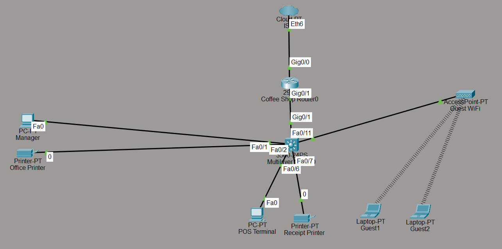
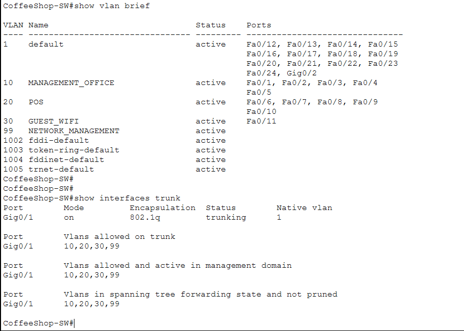
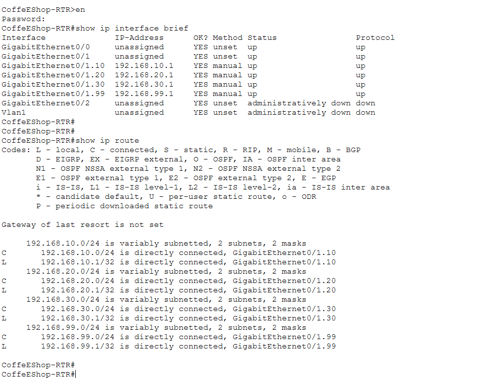
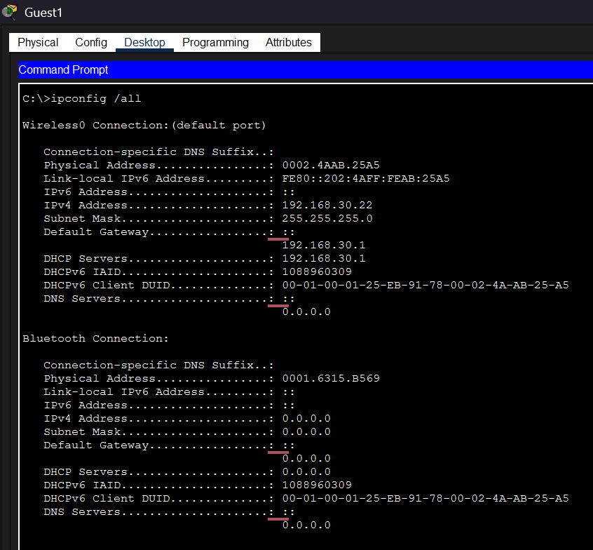
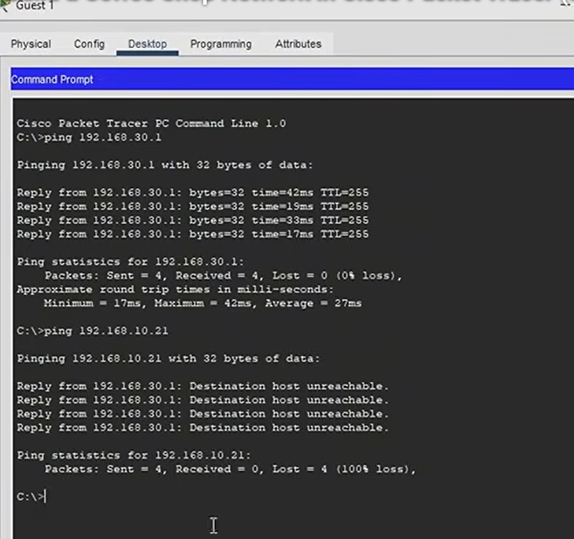

# Coffee Shop Network Design

**Cisco Packet Tracer · Small-Business Network Simulation**

I designed and configured a coffee shop network for a manager’s workstation
and office printer, a point-of-sale (POS) terminal and receipt printer and
two guest laptops. The design separates business and guest traffic with
VLANs, assigns client IP settings through DHCP, and supports remote device
administration over SSH.

[View the Packet Tracer project](./coffee-shop-network.pkt)

## Network topology

The switch connects to the coffee shop router over a trunk on `Gi0/1`.
The guest access point connects to switch port `Fa0/11` and serves the
Guest1 and Guest2 laptops.

## Network configuration

| Feature | Implementation |
| --- | --- |
| VLAN segmentation | Assigned office, POS and guest connections to their respective VLANs using switch access ports. |
| Inter-VLAN routing | Configured 802.1Q subinterfaces on the router’s `Gi0/1` interface to route traffic between VLANs. |
| DHCP | Configured automatic IPv4 addressing and default gateway assignment for clients. |
| Guest Wi-Fi | Configured a wireless access point for guest devices. |
| Access control | Applied standard IPv4 ACLs to enforce the network’s access policy. |
| Remote management | Configured SSH for network device administration. |
| PortFast | Enabled PortFast on switch ports connected to end devices. |

## Verification

### VLAN assignments and trunk

`show vlan brief` displays the switch’s VLANs and access-port assignments.
`show interfaces trunk` displays the trunk toward the router.

### Router-on-a-stick

`show ip interface brief` displays the router subinterfaces.
`show ip route` shows the connected VLAN subnets.

### Guest Wi-Fi and DHCP

On Guest1, I checked the assigned IPv4 address, subnet mask and default
gateway, then pinged the gateway to test connectivity from the wireless client.

### Access control

I compared a permitted connection with a restricted connection to check
whether traffic followed the intended ACL policy.

